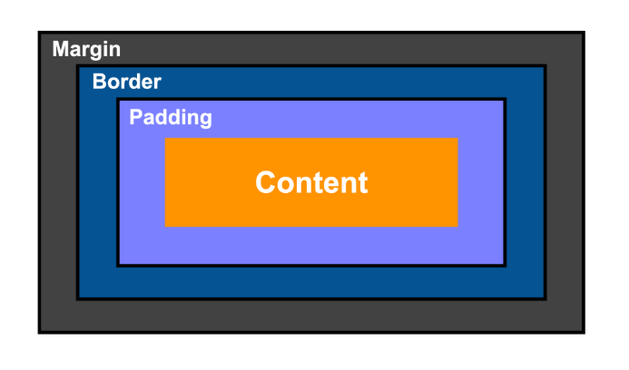

*More on [CSS Review](https://www.freecodecamp.org/learn/responsive-web-design-v9/review-css/review-css)*

```html
<!-- link to stiles.css in html -->
<link rel="stylesheet" href="styles.css">
```

```css
selector {
  property: value;
}
```

```css
/* comment */
```

| selector | value | description |
| -- | -- | -- |
| `html element` |  |  |
| `.class-name` |  |  |
| `#id-name` |  |  |

| combinator | description |
| -- | -- |
| `space` |  |
| `>` | select elements that are direct children of a specified parent element |
| `+` | selects an element that immediately follows a specified sibling element |
| `~` | selects all siblings of a specified element that come after it |

## Inline css
```html
<p style="color: green;">This is an inline-styled paragraph.</p>
```
```html
<head>
  <style>
    p {
      color: blue;
    }
  </style>
</head>
<body>
  <p>This paragraph is styled using internal CSS.</p>
</body>
```

## Calculating Specificity Values 

| Specificity Values | `(a, b, c, d)` | 0 or 1 |
| -- | -- | -- |
| `a` | Inline styles | have the highest weight, contributing a value of 1 to the first part of the specificity value |
| `b` | ID selectors | carry the next highest weight, with each ID contributing 1 to the second part of the specificity value |
| `c` | Class selectors, attribute selectors, and pseudo-classes | carry moderate weight, with each contributing 1 to the third part of the specificity value |
| `d` | Type selectors and pseudo-elements | have the lowest weight, with each contributing 1 to the fourth part of the specificity value |
| `*` | Universal selector | contributes 0 to the specificity calculation and does not affect specificity |

*Сравнение идёт слева направо — больше значение в `a` важнее, чем любые суммы в `b`, `c`, `d` и т. д.*

<details>
<summary>Example</summary>

| Selector | Specificity |
|---------|---------------|
| `div` | `(0, 0, 0, 1)` |
| `.menu` | `(0, 0, 1, 0)` |
| `#header .title` | `(0, 1, 1, 0)` |
| `style="color:red"` | `(1, 0, 0, 0)` |
| `div.item:hover` | `(0, 0, 2, 1)` |

</details>

## Box Model

