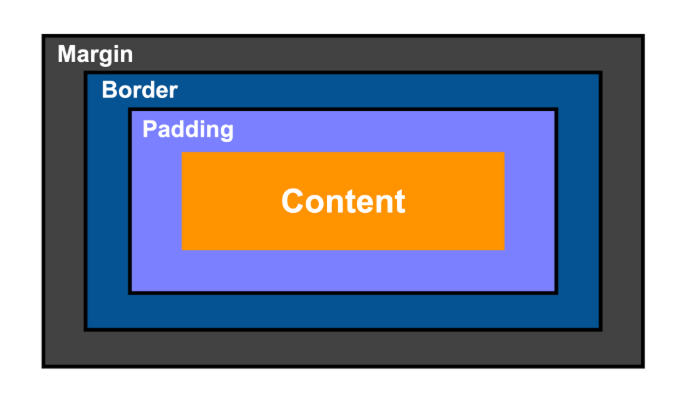
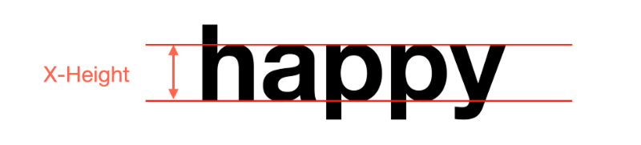
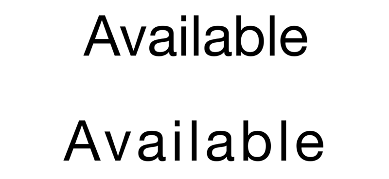
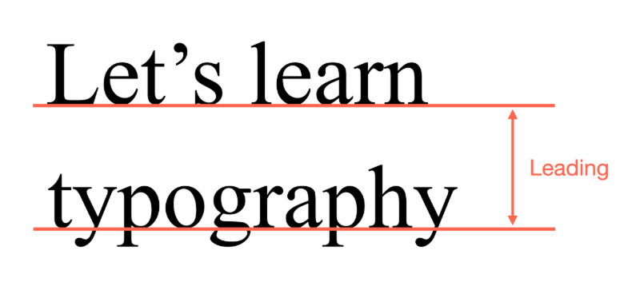

*More on [CSS Review](https://www.freecodecamp.org/learn/responsive-web-design-v9/review-css/review-css)*

```html
<!-- link to stiles.css in html -->
<link rel="stylesheet" href="styles.css">
```

```css
selector {
  property: value;
}
```

```css
/* comment */
```

| selector | value | description |
| -- | -- | -- |
| `html element` |  |  |
| `.class-name` |  |  |
| `#id-name` |  |  |

| combinator | description |
| -- | -- |
| `space` |  |
| `>` | select elements that are direct children of a specified parent element |
| `+` | selects an element that immediately follows a specified sibling element |
| `~` | selects all siblings of a specified element that come after it |

## Inline css
```html
<p style="color: green;">This is an inline-styled paragraph.</p>
```
```html
<head>
  <style>
    p {
      color: blue;
    }
  </style>
</head>
<body>
  <p>This paragraph is styled using internal CSS.</p>
</body>
```

## Calculating Specificity Values 

| Specificity Values | `(a, b, c, d)` | 0 or 1 |
| -- | -- | -- |
| `a` | Inline styles | have the highest weight, contributing a value of 1 to the first part of the specificity value |
| `b` | ID selectors | carry the next highest weight, with each ID contributing 1 to the second part of the specificity value |
| `c` | Class selectors, attribute selectors, and pseudo-classes | carry moderate weight, with each contributing 1 to the third part of the specificity value |
| `d` | Type selectors and pseudo-elements | have the lowest weight, with each contributing 1 to the fourth part of the specificity value |
| `*` | Universal selector | contributes 0 to the specificity calculation and does not affect specificity |

*Сравнение идёт слева направо — больше значение в `a` важнее, чем любые суммы в `b`, `c`, `d` и т. д.*

<details>
<summary>Example</summary>

| Selector | Specificity |
|---------|---------------|
| `div` | `(0, 0, 0, 1)` |
| `.menu` | `(0, 0, 1, 0)` |
| `#header .title` | `(0, 1, 1, 0)` |
| `style="color:red"` | `(1, 0, 0, 0)` |
| `div.item:hover` | `(0, 0, 2, 1)` |

</details>

## Box Model



## Typography

`Serif` typeface - classical style with small lines at the end of characters  
`Sans Serif` typeface - modern look, without the small lines at the end of characters

|  |  |  |
|--|--|--|
|  |  | 

|  |  |
|--|--|
|  |  |

| Kerning | Tracking | Leading | 
|--|--|--|
|  |  |  |

## Accessibility


- **WebAIM Color Contrast Checker** — online; enter foreground/background hex codes; instantly checks contrast ratio against WCAG AA/AAA.
- **TPGi Colour Contrast Analyzer** — desktop app; analyzes whole pages, picks colors from screen, simulates color vision deficiencies.
- Both help ensure readable, accessible text/background contrast.
- Use together with manual testing and user feedback.


## AT-Rules

Statements that provide instructions to the browser

### @font-face

```css
@font-face { 
  /* Descriptors */ 
}
```

| descriptor | usage |
|--|--|
| `font-family` | `font-family: "MyCustomFont";` |
| `src` | `src: url("path/to/font") format() tech(color-COLRv1);`<br> format: `collection`, `embedded-opentype`, `opentype`, `svg`, `truetype`, `woff`, `woff2` <br> tech (of the font resource): `tech(color-COLRv1)` |
|  |  |

### @import

```css
@import url()
```

### @media

```css
@media mediatype and (feature: value) {
  /* CSS rules go here */
}
```

#### Mediatypes

| Type | Description |
| --- | --- |
| `all` | Suitable for all devices. Default if no media type is specified. |
| `print` | Intended for paged material and documents viewed in print preview mode. |
| `screen` | Intended primarily for screens. |

#### Media Features

| Feature | Values | Description |
| --- | --- | --- |
| `aspect-ratio` | `<ratio>` e.g. `16/9`; also `min-aspect-ratio`, `max-aspect-ratio` | Ratio between the viewport's width and height |
| `orientation` | `portrait`, `landscape` | Whether the viewport is taller (`portrait`) or wider (`landscape`) |
| `resolution` | `dpi`, `dpcm`, `dppx`; also `min-resolution`, `max-resolution` | Pixel density of the output device (dots per inch / cm / px) |
| `hover` | `none`, `hover` | Whether the **primary** input mechanism can hover over elements |
| `any-hover` | `none`, `hover` | Whether **any** available input mechanism can hover |
| `pointer` | `none`, `coarse`, `fine` | Accuracy of the **primary** pointing device |
| `any-pointer` | `none`, `coarse`, `fine` | Accuracy of **any** available pointing device |
| `prefers-color-scheme` | `light`, `dark` | Detects whether the user requested a light or dark color theme |
| `prefers-reduced-motion` | `no-preference`, `reduce` | Detects whether the user asked the OS to minimize animation |
| `width` / `min-width` / `max-width` | length (`px`, `em`, …) | Viewport width |
| `height` / `min-height` / `max-height` | length (`px`, `em`, …) | Viewport height |
| `display-mode` | `browser`, `minimal-ui`, `standalone`, `fullscreen` | How the app is displayed (useful for PWAs) |

**Media Queries and Logical Operators:** the `and` operator combines multiple media features; `not` and `only` negate or isolate a query.

```css
/* combine features */
@media screen and (min-width: 768px) and (orientation: landscape) {
  /* ... */
}

/* negate a media type */
@media not print {
  /* ... */
}

/* isolate a query (legacy browsers) */
@media only screen and (hover: hover) {
  /* ... */
}

/* prefers-color-scheme */
@media (prefers-color-scheme: dark) {
  body { background: #111; color: #eee; }
}
```

#### Media Breakpoints

`@media screen and (min-width: 768px)`

A popular set of breakpoints corresponds to common device categories:

- Small devices (smartphones): `up` to `640px`
- Medium devices (tablets): `641px` to `1024px`
- Large devices (desktops): `1025px` and `larger`

More granular approach, using breakpoints like:

- Extra small devices: `up` to `576px`
- Small devices: `577px` to `768px`
- Medium devices: `769px` to `992px`
- Large devices: `993px` to `1200px`
- Extra large devices: `1201px` and `larger`

Some other common examples for breakpoints:

- Extra small device: `under 576px`
- Small device: `more than or equal to 576px`
- Medium device: `more than or equal to 768px`
- Large device: `more than or equal to 992px`
- Extra large device: `more than or equal to 1200px`
- Extra extra large device: `more than or equal to 1400px`


### @property

```css
@property --property-name {
  syntax: '<type>';
  inherits: true | false;
  initial-value: <value>;
}
```

- `<type>`: `<color>`, `<length>`, `<number>`, `<percentage>`, `angle` or more complex types
- `inherits` specifies whether the property should inherit its value from its parent element
- `initial-value` sets the default value of the property